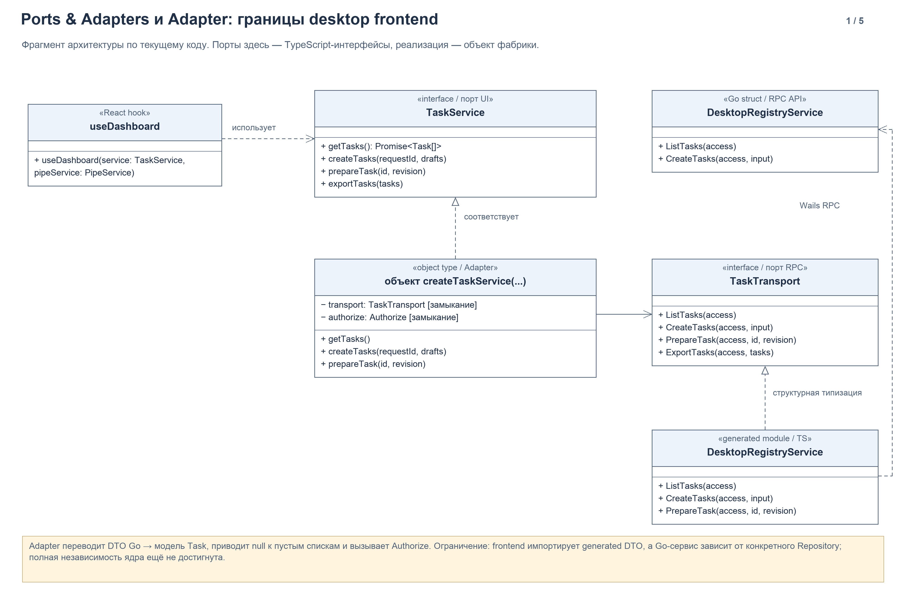
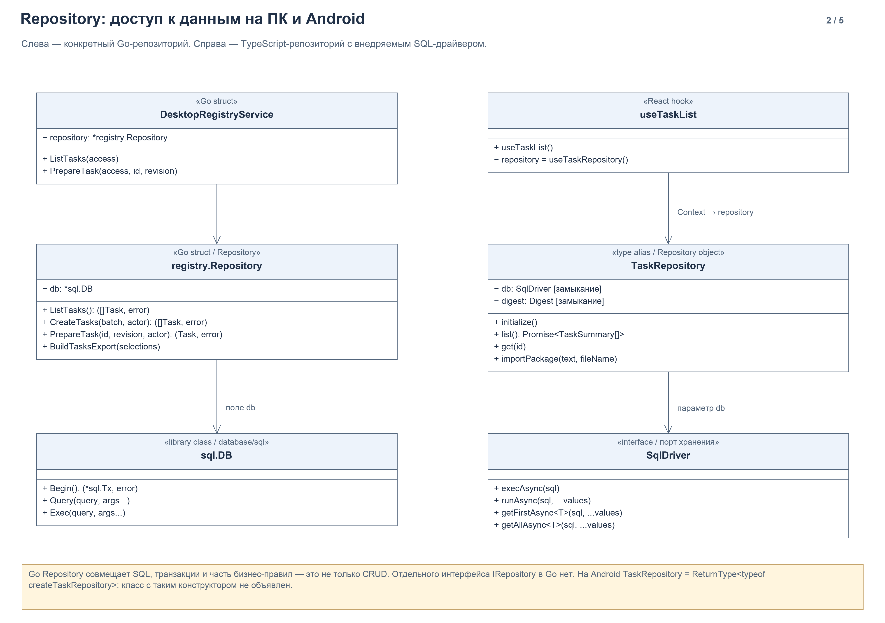
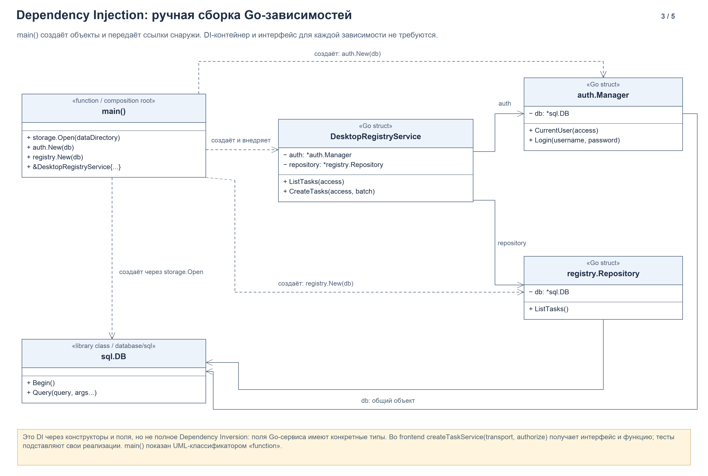
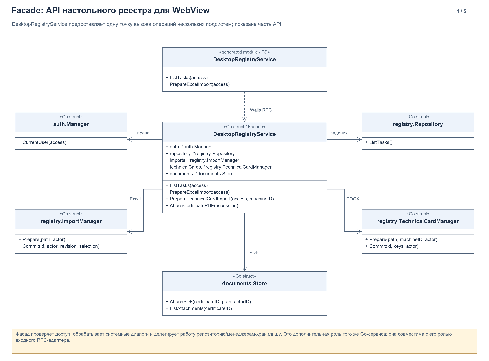
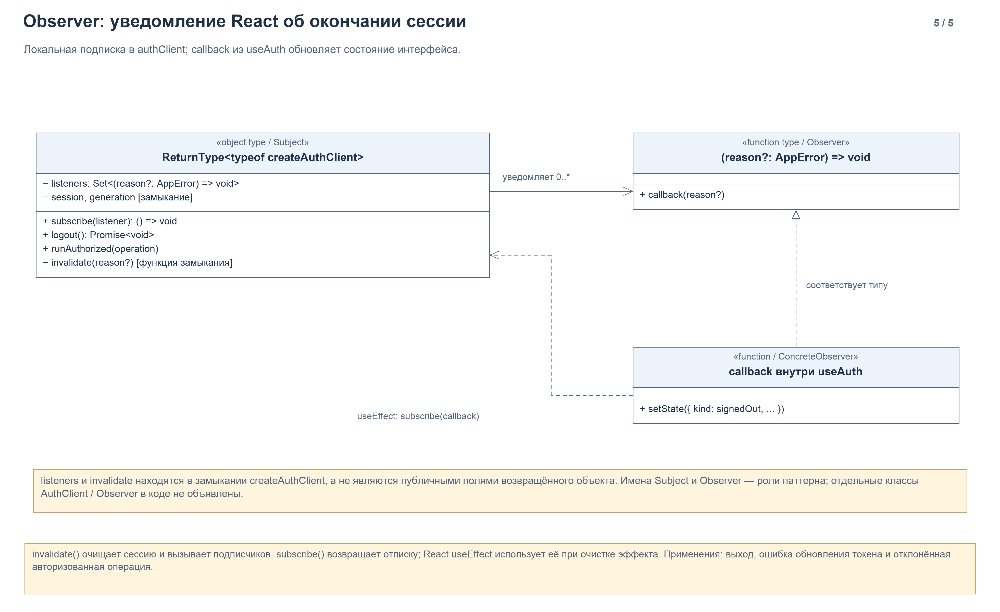

# Паттерны, подтверждённые текущим кодом

Дата проверки: 07.11.2026. Это описание существующей реализации, а не предложение рефакторинга. Прикладной код при подготовке диаграмм не изменялся.

## Что можно утверждать в ВКР

| Решение | Статус и границы | Диаграмма |
| --- | --- | --- |
| Ports & Adapters | Применены отдельные границы на интерфейсах во frontend и мобильном хранилище. Полная гексагональная архитектура всего приложения не реализована. | 01 |
| Repository | Конкретный Go `registry.Repository` и мобильный объект `TaskRepository` инкапсулируют работу с данными. | 02 |
| Dependency Injection | Ручное внедрение через параметры функций, конструкторы, поля структур и React Context. | 03 |
| Adapter | Объект, возвращаемый `createTaskService`, согласует API транспорта с API экрана и преобразует DTO. | 01 |
| Facade | `DesktopRegistryService` предоставляет WebView API нескольких подсистем и координирует их вызовы. | 04 |
| Observer | `createAuthClient` хранит подписчиков; `useAuth` подписывается на недействительность сессии и отписывается при очистке эффекта. | 05 |

Ports & Adapters — архитектурный подход. Repository — паттерн доступа к данным. DI — способ организации зависимостей. Adapter, Facade и Observer — паттерны проектирования. Они могут применяться одновременно к одному фрагменту программы: например, входной RPC-адаптер Go одновременно выступает фасадом.

## Как читать комплект

PNG предназначены для просмотра и вставки в материалы ВКР; SVG сохраняют резкость при масштабировании. [draw.io с пятью страницами](../diagrams/2026-11-07-implemented-patterns/implemented-patterns.drawio) содержит редактируемые элементы. Рядом лежат `.puml` — текстовые версии взаимодействующих типов; компоновка PlantUML может отличаться от PNG.

Диаграммы являются выборочными представлениями типов. Часть методов, типов параметров и зависимостей опущена. Сплошная направленная связь обозначает использование удерживаемой зависимости, пунктирная открытая стрелка — зависимость/вызов/создание, пунктирная стрелка с пустым треугольником — реализацию контракта, включая структурное соответствие TypeScript.

В Go используются структуры с методами, а TypeScript-код часто возвращает объекты из функций. Поэтому стереотипы `Go struct`, `interface`, `object type`, `function` и `React hook` поясняют, какой элемент исходников представлен классификатором UML. Они не означают, что в проект добавлены классы. Закрытое состояние замыкания обозначено явно. В классификаторе `main()` приведены вызовы внутри функции, а не её методы.

## 01. Ports & Adapters и Adapter

Источник: [taskService.ts](../../apps/desktop/frontend/src/features/tasks/taskService.ts), [taskClient.ts](../../apps/desktop/frontend/src/features/tasks/taskClient.ts), [useDashboard.ts](../../apps/desktop/frontend/src/features/dashboard/useDashboard.ts), [registryservice.go](../../apps/desktop/registryservice.go).

`useDashboard(service: TaskService, pipeService: PipeService)` принимает сервисы как параметры. Экранная логика работает с операциями `getTasks`, `createTasks`, `prepareTask`, а не с Wails API напрямую. `TaskService` служит контрактом для потребителя. `TaskTransport` определяет операции внешнего RPC-транспорта. Фабрика `createTaskService(transport, authorize)` создаёт объект, который соответствует `TaskService`, вызывает транспорт, нормализует ответы и переводит DTO в модель представления через `toTask`.

В `taskClient.ts` передаются реальный сгенерированный модуль `DesktopRegistryService` и функция `authClient.runAuthorized`. В [registryClients.test.mjs](../../apps/desktop/frontend/tests/registryClients.test.mjs) фабрики получают тестовые объекты транспорта и функцию авторизации. Это существующая точка подмены зависимости.

На мобильной стороне аналогичная граница есть в `createTaskRepository(db: SqlDriver, digest: Digest)`: код репозитория знает контракт SQL-драйвера. [database.ts](../../apps/mobile/src/storage/database.ts) передаёт объект Expo SQLite и функцию SHA-256 из Expo Crypto; [tasks.test.cjs](../../apps/mobile/tests/tasks.test.cjs) передаёт обёртку над `node:sqlite` и функцию из `node:crypto`. Это хеширование содержимого пакетов, не проверка подлинности подписи и не хранение пароля.

**Граница утверждения:** Go `DesktopRegistryService` содержит поле `*registry.Repository`, а не порт репозитория. Сам репозиторий содержит SQL и бизнес-правила подготовки. Frontend также импортирует сгенерированные DTO. Поэтому корректно писать «применены элементы Ports & Adapters», не «вся система реализована как независимое гексагональное ядро».

## 02. Repository

Источник: [repository.go](../../apps/desktop/internal/registry/repository.go), [tasks.go](../../apps/desktop/internal/registry/tasks.go), [task_preparation.go](../../apps/desktop/internal/registry/task_preparation.go), [task_export.go](../../apps/desktop/internal/registry/task_export.go), [taskRepository.ts](../../apps/mobile/src/storage/taskRepository.ts).

На ПК `registry.Repository` получает `*sql.DB`. Операции `ListTasks`, `CreateTasks`, `PrepareTask` и `BuildTasksExport` скрывают SQL-запросы и детали транзакций от Wails-сервиса. Это конкретный репозиторий с частью сценарной логики; отдельный интерфейс `IRepository` не объявлен.

На Android фабрика `createTaskRepository` возвращает объект с `initialize`, `list`, `get`, `packageCount` и `importPackage`. Тип `TaskRepository` выводится как `ReturnType<typeof createTaskRepository>`. Репозиторий скрывает схему мобильных таблиц, последовательную очередь доступа и транзакционный импорт пакета. Отдельного класса `TaskRepository` с конструктором в исходниках нет.

Польза для проекта: экран читает задания и запускает импорт через операции репозитория; SQL и правила сохранения находятся в одном месте. При этом текущий Go-репозиторий нельзя описывать как полностью отделённый от бизнес-логики слой.

## 03. Dependency Injection

Источник: [main.go](../../apps/desktop/main.go), [authservice.go](../../apps/desktop/authservice.go), [taskClient.ts](../../apps/desktop/frontend/src/features/tasks/taskClient.ts), [TaskStorageProvider.tsx](../../apps/mobile/src/storage/TaskStorageProvider.tsx).

`main()` — место сборки настольного приложения: открывает БД, создаёт `documents.Store`, `auth.Manager`, репозиторий и менеджеры импорта, затем передаёт их в Wails-сервисы. `registry.New(db)` получает уже открытое подключение. `newDesktopAuthService(manager)` получает готовый менеджер. Функции системных диалогов также передаются в поля сервиса; [registryexchange_test.go](../../apps/desktop/registryexchange_test.go) подставляет функции для отмены диалога и ошибок записи.

Это ручной DI через конструкторы и инициализацию полей. DI не требует, чтобы тип каждой зависимости был интерфейсом. Однако конкретные типы полей означают, что Go-слой ещё не полностью следует инверсии зависимостей.

В TypeScript зависимости передаются как аргументы `createTaskService(transport, authorize)` и `createAuthClient(transport, now)`. На Android `TaskStorageProvider` открывает репозиторий и предоставляет его через Context; `useTaskRepository()` получает предоставленный объект. Это существующие способы внедрения, без отдельного DI-фреймворка.

## 04. Facade

Источник: [registryservice.go](../../apps/desktop/registryservice.go), [registrydocuments.go](../../apps/desktop/registrydocuments.go), [registrytechnicalcards.go](../../apps/desktop/registrytechnicalcards.go), [registryexchange.go](../../apps/desktop/registryexchange.go).

`DesktopRegistryService` предоставляет внешний API реестра. Например, `PrepareExcelImport` проверяет администратора, открывает системный диалог, обрабатывает отмену и передаёт путь/исполнителя в `ImportManager.Prepare`. Для техкарт вызывается `TechnicalCardManager`, для PDF — `documents.Store`, для заданий — `registry.Repository`.

Frontend не координирует эти Go-подсистемы самостоятельно. Фасад объединяет доступ к ним и выполняет проверку полномочий. Это интерпретация существующей роли сервиса, а не новый класс с именем `Facade`.

## 05. Observer

Источник: [authClientCore.ts](../../apps/desktop/frontend/src/features/auth/authClientCore.ts), [useAuth.ts](../../apps/desktop/frontend/src/features/auth/useAuth.ts).

В замыкании `createAuthClient` находится `Set` подписчиков. `subscribe(listener)` добавляет callback и возвращает функцию удаления подписки. `invalidate(reason)` очищает локальную сессию и вызывает подписчиков. В `useAuth` callback переводит состояние интерфейса в `signedOut`. Возвращённая отписка используется как cleanup функции `useEffect`.

Это функциональная реализация Observer: Subject — объект клиента вместе с его замыканием, Observer — callback, а конкретный наблюдатель — обработчик внутри `useAuth`. Классов с именами `Subject`, `Observer` или `AuthClient` в проекте нет. Паттерн относится к уже существующему desktop frontend; предложенная ранее мобильная авторизация пока не реализована.

## Что не следует приписывать проекту

| Название | Что найдено и почему отдельная реализация не заявлена |
| --- | --- |
| Bridge | Wails связывает JavaScript и Go, но это не доказательство GoF Bridge. Собственной пары независимо расширяемых иерархий Abstraction / Implementor не найдено. |
| Builder | В `main.go` используются цепочки методов диалога Wails. Это API библиотеки. Собственного пошагового строителя сложного объекта нет; метод `BuildTasksExport` сам по себе не означает Builder. |
| Decorator | `runAuthorized` оборачивает выполнение callback, но нет отдельного объекта-декоратора с тем же интерфейсом, что и оборачиваемый компонент. Высшую функцию можно описать как обёртку авторизации, не как реализованную классическую структуру GoF Decorator. |
| Singleton | `authClient` / `taskService` экспортируются как созданные на уровне модуля объекты; мобильный `opening` кеширует Promise открытия репозитория. Это повторное использование экземпляра в области модуля. Фабрики остаются доступны, глобальная уникальность экземпляра не обеспечивается. |
| Factory Method / Abstract Factory | `New`, `createTaskService` и `createAuthClient` — конструкторы/простые фабрики. Иерархии создателей или семейства абстрактных фабрик нет. |
| State | Статусы заданий есть, отдельных объектов-состояний с полиморфным поведением нет. Диаграмма состояний задания не означает применение GoF State. |
| Strategy | Внедряемые функции задают заменяемое поведение; отдельную производственную иерархию стратегий не выделяли. В этом комплекте они показаны как функциональные зависимости DI. |

Эти паттерны не требуется добавлять ради количества диаграмм. Если появится практическая необходимость, изменение кода и его диаграммы следует описать отдельно.

## Формулировка для текста ВКР

> В прототипе используется разделение представления, прикладных сервисов и доступа к данным. Для отдельных границ применены элементы подхода Ports & Adapters: интерфейсы сервисов и транспорта во frontend, интерфейс SQL-драйвера в мобильном приложении. Доступ к локальным данным инкапсулирован в репозиториях, зависимости передаются при сборке приложения и через параметры фабрик. Настольный API реестра выполняет роль фасада подсистем. Преобразование транспортных DTO реализует роль адаптера, а уведомление интерфейса об окончании сессии построено на подписках Observer. При этом Go-сервисы пока зависят от конкретных реализаций репозиториев, поэтому полная независимость доменного ядра от инфраструктуры не заявляется.
