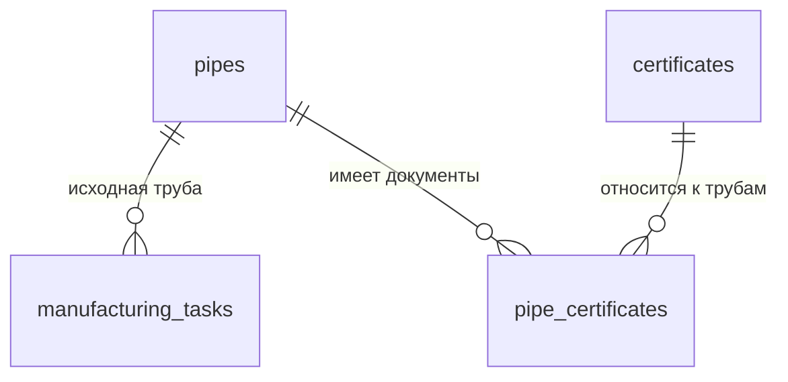

# Трубный журнал и связь с заданиями

В журнале хранится отдельная запись о конкретной исходной трубе. Задание выбирает её по стабильному `pipeId`, а не по подписи в списке или номеру трубы из другого задания. Начальные таблицы пусты: рабочие документы не зашиваются в приложение и не попадают в Git.

## Что реализовано



- `pipes`: идентификация, характеристики, дополнительные сведения, версия записи, время и автор создания/правки.
- `certificates`: полные реквизиты сертификата, номер, дата, количество листов и издатель. Полные реквизиты сохраняются независимо от разобранных полей.
- `pipe_certificates`: явная связь многие-ко-многим. Сертификат можно выбрать повторно для другой трубы. Совпадение текста реквизитов не вызывает автоматическое объединение документов.
- `manufacturing_tasks`: внешний ключ `pipe_id`, версия записи `pipe_revision`, полный `pipe_snapshot_json`, номер задания/отвода, указанные руководителем модель станка и целевой угол, статус черновика и автор создания.

Рабочее хранилище — существующая локальная SQLite приложения. Миграция 003 добавляет таблицы к базе с учётными записями, сохраняя данные предыдущих версий. При создании и изменении всё записывается транзакционно. Go проверяет действующую сессию и роль руководителя перед каждой операцией; недоступность кнопки в React не заменяет эту проверку.

## Состав карточки трубы

Взяты все 19 основных граф изученного трубного журнала. Рядом в исходной книге есть вспомогательный справочник соответствия плавки и эквивалента углерода: это отдельные данные для заполнения графы, а не второй номер плавки той же трубы.

| Группа | Поля |
| --- | --- |
| Идентификация | Заводской номер, изготовитель; дополнительно внутренний инвентарный номер записи |
| Геометрия и масса | Наружный диаметр, толщина стенки, длина в мм, масса в кг |
| Материал | Класс прочности, марка стали, номер плавки, эквивалент углерода в процентах, ТУ/стандарт трубы |
| Покрытие | Тип изоляции/покрытия, ТУ покрытия |
| Документы | Реквизиты сертификата, реквизиты документа входного контроля |
| Условия эксплуатации | Испытательное давление в МПа, минимальная температура стенки, категории применения при рабочем давлении 5,4 и 7,4 МПа |
| Расширение | Примечание и `attributes_json` для остальных характеристик |

Заводской номер хранится текстом: допустимы ведущие нули, точки, дефисы и буквы. Он не объявлен глобально уникальным. Инвентарный номер уникален внутри этого журнала; `id` остаётся независимым от обоих номеров. Записи, обозначающие секции из нескольких труб, нельзя автоматически разбивать по дефису: в заводских номерах этот знак тоже встречается. Составные заготовки требуют отдельной согласованной модели состава.

Неизвестное число хранится как SQL NULL и JSON null. Нулевое значение и отсутствие данных различаются. Обязательны инвентарный и заводской номера; перед подготовкой задания к передаче дополнительно нужны диаметр, стенка и длина. Неполный черновик можно сохранить раньше. Это проверка заполнения данных, а не заключение о пригодности трубы к гибке.

Категории применения вводятся как значения из документа. Формулы Excel, режимы гибки, допуски и автоматическая совместимость со станком в этой версии не реализованы. Прежние демонстрационные сочетания труб и станков удалены.

## Дополнительные сведения

Предусмотреть абсолютно все будущие сертификаты одной таблицей невозможно. Основные поля имеют понятные типы и единицы, а сведения нового вида можно сохранить без изменения таблицы:

```json
{
  "schemaVersion": 1,
  "customFields": [
    {"name": "Дополнительная характеристика", "value": "исходное значение", "unit": "единица из документа"}
  ]
}
```

В интерфейсе это строки «характеристика — значение — единица», а не редактор JSON. Сервер принимает только JSON-объект до 64 КБ. Вложенные неизвестные ключи и сведения о происхождении сохраняются при редактировании известных полей. Известные числовые поля не вычисляются из этого JSON и не заменяются его одноимёнными ключами.

Для повторяющихся результатов испытаний и химического состава позже можно выделить дочерние таблицы, если появятся запросы, фильтрация или расчёты по ним. Это обычная миграция, а не перенос всех данных вручную. До этого исходное значение, единица и контекст сохраняются в расширении.

## История задания

Создание задания читает трубу и сохраняет снимок в одной транзакции. Поздняя правка журнала повышает `revision`, но не меняет ранее созданный снимок. Если открытая форма использует устаревшую версию, Go возвращает `CONFLICT` вместо молчаливой перезаписи. Внешний ключ не разрешает удалить трубу, на которую ссылается задание.

На Android впоследствии передаются ID и снимки трубы и конфигурации вместе с заданием, а не рабочий файл SQLite. Наличие задания ещё не резервирует трубу и не означает начало производства; правила резервирования и составных заготовок нужно согласовать отдельно.

Миграция 005 добавляет каталог `technological_configurations`, ревизию и порядок задания, тип отвода, примечание, ссылку/снимок конфигурации и данные подготовки. Старые задания сохраняют исходные сведения и получают очередь в порядке `created_at,id`. Автоматическое заполнение отсутствующей конфигурации не выполняется.

Минимальная конфигурация хранит название, версию документа, станок, реквизиты ТК, диаметр и список вручную перенесённых параметров. Этот список сохраняет исходные текстовые значения и единицы, включая обозначения вроде ±; он не является исполняемой формулой и не задаёт автоматически нормы, режимы или способ получения H. Полный редактор технологических карт и расчёт плана — отдельные задачи.

Черновик допускает незаполненную шапку, но требует конкретную трубу и актуальную ревизию. При его правке повторно читаются выбранные источники и сохраняются снимки для предпросмотра. Подготовка проверяет заполнение шапки, версии, основные размеры и диаметр конфигурации; сохраняет полные снимки в одной транзакции, `snapshotVersion=1`, автора/время и фиксирует новую ревизию задания. Изменения исходников после просмотра не подхватываются молча: `CONFLICT` требует заново проверить и сохранить черновик.

После `draft → ready` задание неизменно: Go запрещает редактирование, SQLite — UPDATE/DELETE подготовленного содержимого. Поддержка новых ревизий и дальнейших переходов `sent/completed` потребует отдельной реализации жизненного цикла и соответствующей миграции ограничений. Это ограничение первой версии, а не универсальный статусный механизм.

`queue_position` — отдельное уникальное сохраняемое число; оно определяет порядок будущей очереди Android и не вычисляется из номера отвода/задания. Группа до 50 заданий создаётся в порядке входного списка одной транзакцией. `task_creation_requests` сохраняет ID операции, автора, хеш нормализованных входов и ID заданий: одинаковый повтор возвращает результат, изменённые данные с тем же ID отклоняются. Редактирование не меняет позицию. Перестановка уже сохранённой очереди в этот этап не входит.

## Границы сущностей

Температура воздуха и метеоусловия относятся к сеансу. Подтверждённые измерения относятся к его физическим шагам. Фактические диаметры по сечениям готового отвода, овальность, состояние покрытия, дефекты и заключение контроля относятся к результату/контролю готового изделия. Они не должны перезаписывать характеристики исходной трубы. Полный паспорт изделия не формируется этим изменением.

Документ системного анализа содержит ранние предложения об общем сервере, REST/WebSocket и РЕД ОС. Они рассматриваются как проектные материалы; реализация сохраняет актуальную архитектуру Windows Wails + Go и отдельного Android Expo с автономными БД.

## Импорт и оригиналы

Миграция 004 добавляет `document_files`, `certificate_documents`, `document_link_events`, `registry_imports`, `registry_import_rows`. Оригиналы XLSX/PDF сохраняются в закрытом каталоге `documents/<тип>/<префикс хеша>/<SHA-256>.<тип>` рядом с БД. SQL содержит метаданные и связи, а не двоичные файлы. Исходное имя не участвует в построении пути. Один PDF может иметь несколько связей; снятие связи не удаляет оригинал. События attach/detach сохраняют пользователя и время. SHA-256 подтверждает совпадение содержимого, не юридическую подлинность.

Excel проходит ограничение размера и ZIP/XML до разбора. Лист, заголовки, столбцы и единицы доступны для проверки и настройки. В БД сохраняются оригинал, конфигурация, черновые строки, координаты и исходные значения/формулы. Неизвестные графы и вспомогательные справочники остаются в источнике. Формулы не вычисляются, внешние ссылки не загружаются; используются только сохранённые результаты. Ошибочный или отсутствующий результат помечается ошибкой, неизвестное число остаётся null. Пустые строки с протянутыми формулами не создают трубы.

Черновик принадлежит создавшему его руководителю и доступен после перезапуска. Исправление строки меняет черновик, не журнал; сервер сохраняет происхождение независимо от присланной формы. Смена сопоставления перечитывает оригинал и заменяет исправления. Для записи нужны актуальная версия предпросмотра и явный список строк. Перед сохранением повторно проверяются журнал, конфликты и реквизиты; все выбранные трубы, сертификаты и связи записываются одной транзакцией. Ошибка откатывает всю операцию. Повтор того же запроса возвращает сохранённый результат; другая выборка завершённого импорта отклоняется. Повторный выбор исходного файла создаёт новый черновик для пропущенных строк; незавершённый черновик возобновляется.

Правила совпадения консервативны: SHA-256 книги + лист + строка определяют уже импортированное происхождение. Для другого источника нужны заводской номер, изготовитель, плавка и согласованные заполненные свойства; несколько подходящих записей дают конфликт. Совпадение диаметра, имени файла или сертификата не доказывает идентичность трубы. Совпадающие противоречивые строки внутри книги блокируются. Существующие трубы не перезаписываются. Неоднозначные случаи проверяются по оригиналу и разрешаются ручным редактированием журнала.

Общий сертификат группируется в пределах книги по реквизитам и изготовителю. Существующий сертификат переиспользуется только при совпадении полных реквизитов, номера, даты, числа листов и однозначной связи с тем же изготовителем. Изготовитель трубы не назначается автоматически издателем сертификата. PDF прикрепляет человек к выбранным реквизитам; OCR, автоматическое связывание PDF с трубами и DOCX-вложения не реализованы.

Системные диалоги и открытие документов вызываются только после проверки действующей роли руководителя. Путь из WebView не принимается; открытие идёт по ID и подтверждённой связи. Перед открытием проверяются тип пути, размер и SHA-256; символические ссылки в управляемом хранилище отклоняются. Защита прав файлов совпадает с БД. Оригиналы и БД остаются локальными и не включаются в Git. Возможный файл без записи после сбоя сохранения остаётся невидимым оригиналом; автоматическое удаление общих файлов не выполняется.

Проверки: восстановление после открытия БД заново, общий сертификат нескольких труб, одинаковый хеш двух привязок, снятие одной связи без потери другой, испорченный PDF, изменение оригинала, символические ссылки, лимиты Excel, форматированные номера с нулями, точность процентов, сохранённый результат формулы без вычисления, предпросмотр без записи, атомарный откат, повторный запрос, новые конфликты, роль и владелец черновика. Интеграционные тесты с локальными оригиналами включаются переменными `PIPE_TEST_XLSX`, `PIPE_TEST_PDF_ONE`, `PIPE_TEST_PDF_TWO`; документы не помещаются в исходники.

## Станки и импорт ТК

Схема 006 добавляет `machines`, `technical_cards` и происхождение технологических конфигураций. Две записи станков — ГТ532/ГТ1022; неизвестные заводские номера остаются пустыми. Задание ссылается на `machine_id`, подготовка фиксирует снимок оборудования. Конфигурация привязана к станку; неподтверждённые результаты импорта не допускаются к подготовке задания.

Из двух изученных DOCX извлекаются отдельные табличные варианты, без интерполяции и назначения режимов по заводскому диапазону станка. Учитываются границы объединённых столбцов типов 1/2 и представленные таблицы оснастки. Справочные диапазоны свойств труб сохраняются как параметры. Оригинал — неизменяемое вложение по хешу; `source_json` хранит подпись таблицы, координаты, ячейки и сноски. Ключ `(technical_card_id, source_key)` предотвращает повторное добавление. Импорт выбранной группы атомарный. Новый оригинал не заменяет предыдущий каталог.

`needs_review` снимается явным подтверждением сверки в карточке конфигурации. Все значения и сноски доступны рядом с оригиналом. Противоречивые значения остаются исходными с предупреждением. Это контроль переноса данных, а не автоматическая проверка всех инженерных условий. Автоматическое получение H не реализуется. Фактическая погода и температура относятся к будущему сеансу на Android.

Для перестроения таблицы вложений миграции временно отключают проверку внешних ключей на единственном соединении до транзакции; перед фиксацией выполняется `foreign_key_check`, при любой ошибке — откат. Проверка внешних ключей включается обратно до запуска сервисов. Тест миграции сохраняет PDF-связи, историю импорта Excel и неизменяемое подготовленное задание.

### Отображение сведений трубы, режима и справочной таблицы

Карточка задания разделяет сведения конкретной трубы из сохранённого снимка журнала, параметры выбранного табличного режима и справочные сведения для группы труб. Фактическая толщина и класс прочности берутся только из записи трубы; неизвестный класс не заполняется диапазоном из ТК.

Для существующих конфигураций пять полей, помеченных импортёром суффиксом «— справочная таблица», выделяются отдельно в UI. Произвольные и неизвестные параметры остаются в группе режима без удаления. Справочные значения показываются только для чтения; редактор режима при сохранении объединяет изменённые параметры с сохранёнными справочными полями. Тексты, единицы, звёздочки и неизвестные параметры сохраняются. Формат SQLite/JSON и ранее подготовленные снимки не изменяются, повторный импорт не требуется.

Источник справочного блока — `sourceJson.referenceTable` (подпись, строка, исходный диаметр) и имя исходного документа. Позиция не подменяется координатами таблицы режимов. При отсутствии метаданных интерфейс явно предлагает сверку с оригиналом. Справочные диапазоны не используются как автоматическое подтверждение применимости трубы; подтверждение сверки остаётся отдельным действием пользователя.
